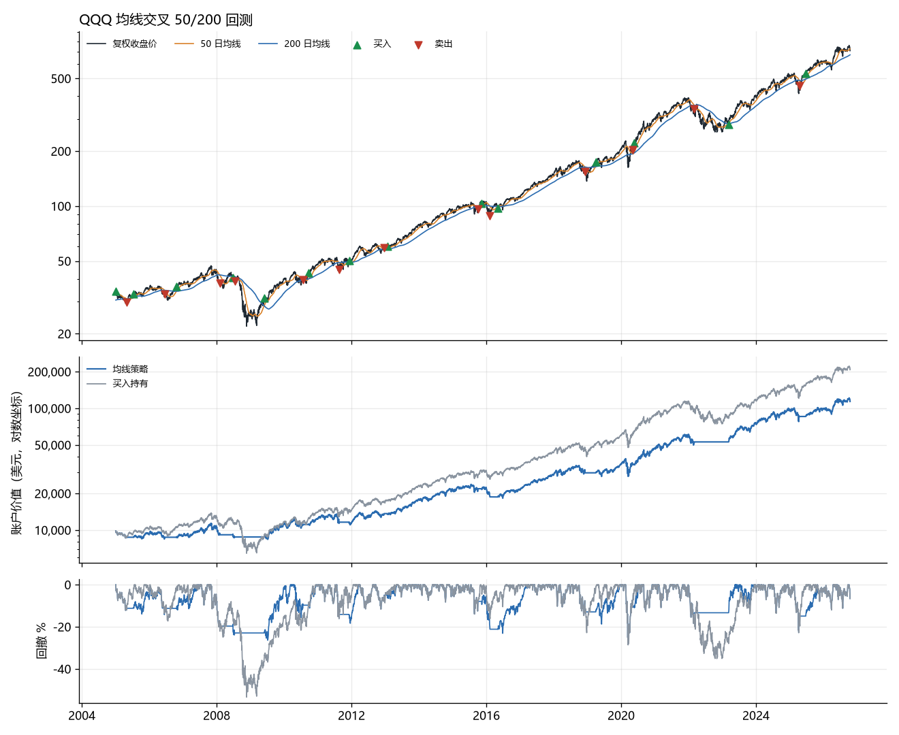

# quant-lab

一个用来学习量化交易的小项目：对美股和港股做**均线交叉策略**的历史回测，并且每天给出信号。

- **数据**：Yahoo Finance 日线，已按拆股和分红**复权**，缓存在本地 SQLite。
- **回测**：只做多或空仓。按收盘价算信号，**下一个交易日开盘成交**，避免用到当时还看不到的价格。计入滑点和手续费，按整股成交。
- **对比**：每次回测都和同期“买入持有”比较。
- **报告**：年化收益、波动率、夏普比率、最大回撤、持仓时间占比、胜率；输出交易明细 CSV 和图表。
- **信号**：查看每只股票当前处于持有还是空仓，以及今天是否刚出现金叉或死叉。

> 本项目只用于学习和研究，不会下单，也不构成投资建议。回测结果不代表未来表现。

## 安装

需要 Python 3.10 或以上版本。

```bash
pip install -r requirements.txt
```

## 用法

回测（默认 50 日和 200 日均线，初始资金 1 万美元）：

```bash
python -m quant backtest QQQ --start 2005-01-01
```

```
QQQ  均线 50/200  2005-01-03 → 2026-10-16（21.8 年）
初始资金 $10,000 · 每笔手续费 $0 · 滑点 5 bp · 信号按收盘价计算，下一个交易日开盘成交

                均线策略                            买入持有
  期末资产      $113,940                            $207,980
  年化收益      +11.8%                              +14.9%
  夏普比率      0.74                                0.76
  最大回撤      -28.5%（2020-02-19 → 2020-03-16）   -53.4%（2007-10-31 → 2008-11-20）
  ...
```

图表和交易明细保存在 `reports/` 目录。



常用参数：

| 参数 | 含义 | 默认值 |
| --- | --- | --- |
| `--fast` / `--slow` | 短、长均线天数 | 50 / 200 |
| `--start` / `--end` | 回测区间 | 长均线算得出来的第一天 / 最近一个交易日 |
| `--cash` | 初始资金（美元） | 10000 |
| `--fee` | 每笔手续费（美元） | 0 |
| `--slippage` | 滑点（基点，1 bp = 0.01%） | 5 |
| `--rf` | 无风险年利率，用于计算夏普比率 | 0 |
| `--refresh` | 忽略缓存，重新下载数据 | |

每日信号：

```bash
python -m quant signal QQQM VOO MCD 700
```

港股直接写代码数字，比如 `700` 表示腾讯控股。

如果想每天自动运行，可以在美股收盘后（北京时间早上）用 Windows 任务计划程序或 Linux 的 cron 执行上面这条命令，例如 cron：

```
30 7 * * 2-6 cd /path/to/quant-lab && python -m quant signal QQQM VOO >> signals.log
```

## 回测是怎么算的

1. 用全部历史数据计算均线。信号是“短均线在长均线上方就持有”，按当天收盘价计算。
2. 第二天开盘按信号成交：买入价是开盘价加滑点，卖出价是开盘价减滑点，每笔再扣手续费。
3. 每天收盘时的账户价值 = 现金 + 持股数 × 收盘价。
4. 回测窗口开始前的信号也会生效，所以窗口第一天就可以处于持有状态。“买入持有”在窗口第一天开盘买入。

复权价格把分红算作再投资，所以“买入持有”的结果是含分红的总收益。

## 指标说明

| 指标 | 含义 |
| --- | --- |
| 年化收益 | 把总收益折算成每年的复合收益率 |
| 年化波动率 | 日收益率的标准差 × √252，衡量涨跌幅度有多大 |
| 夏普比率 | （年化收益 − 无风险利率）÷ 年化波动率，衡量每承担一份波动换来多少收益 |
| 最大回撤 | 从历史最高点跌到之后最低点的最大跌幅 |
| 持仓时间占比 | 收盘时持有股票的天数占比 |
| 胜率 | 已平仓的交易中赚钱的比例 |

## 项目结构

```
quant/
  data.py        下载、复权、缓存日线（SQLite）
  strategy.py    均线交叉策略：价格 → 每天的目标仓位
  backtest.py    回测引擎：逐日模拟成交和账户价值
  metrics.py     绩效指标
  report.py      图表
  __main__.py    命令行
tests/           单元测试：不偷看未来、手续费和滑点、最大回撤等
```

运行测试：

```bash
python -m pytest
```

## 已知局限

- 只支持单只股票、只做多或空仓；空仓时的现金没有利息。
- Yahoo 的数据是非官方接口，偶尔会限流或修改格式。
- 不考虑分红税、退市股票（幸存者偏差）和盘中价格。

## 接下来可以做

- **参数扫描 + 样本外检验**：在前一段数据上选参数，在后一段数据上检验，看结果是否过拟合。
- 更多策略：动量轮动、RSI 均值回归、定投加再平衡。
- 多只股票的组合回测。
- 把每天的信号记成模拟交易，长期对比实际表现。

## 许可

MIT
