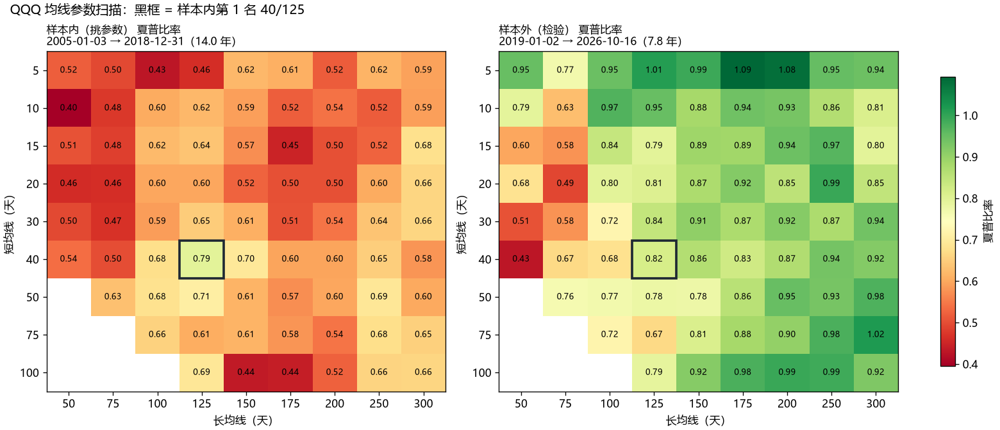

# QuantLab 量化研究工作站

> **已迁移**：这个仓库已经并入 [AI量化交易分析平台](https://github.com/Wwz123Abc/ai-quant-platform)（`quantlab/` 目录，提交历史完整保留），这里不再更新。

美股和港股的量化研究工具：**回测**、**参数扫描与样本外检验**、**每日信号**、**模拟盘**。可以在命令行使用，也可以打开网页工作台。

它分成两端：

- **分析端**：想买一只股票时，`个股分析` 给出趋势和风险、时点基本面、AI 评级、和你现有持仓的相关性，以及**按你的规则**能不能买、最多买多少。
- **执行端**：`我的持仓` 每天从账本同步你的真实持仓，按你设定的规则（目标仓位和再平衡区间、单只上限、现金储备）给出建议订单；你逐条确认，自己去券商下单。趋势、基本面和 AI 评级只作为提醒，不会生成订单。

- **数据**：Yahoo Finance 日线，按拆股和分红复权，缓存在本地 SQLite；国内服务器上改用腾讯 K 线 + 新浪复权因子（`QUANTLAB_PRICE_SOURCE=cn`）。
- **回测**：按收盘价算信号，**下一个交易日开盘成交**，计入滑点和手续费、按整股成交，并和同期“买入持有”对比。
- **样本外检验**：在前一段历史上挑参数，在后一段历史上检验，判断“最优参数”是不是过拟合。
- **模拟盘**：每个交易日收盘后记录策略的决定，写入后不可修改，是真正的前向测试。
- **机器学习选股**：纳斯达克 100 成分股，12 个价格和成交量因子，LightGBM 滚动训练（清除标签重叠，超参数事先固定），按波动率倒数分配仓位，和动量、等权、QQQ 用同样的规则和成本比较。
- **自动交易**：月末按模型组合自动调仓；计划 / 模拟券商 / 实盘三种模式，每笔订单都过风控（资金上限、白名单、单只上限、单笔和单日上限、数据异常检查、回撤熔断），全部操作写入审计日志。目前接内置模拟券商，实盘需要券商连接器。
- **AI 研报**：接入 [TradingAgents](https://github.com/TauricResearch/TradingAgents) 多智能体（分析师 → 多空辩论 → 交易员 → 风控），给出 5 档评级和完整报告；按 token 记账，每月预算硬上限；AI 评级可以作为模拟账户的信号来源，和均线策略、买入持有放在一起比较。
- **工程化**：分层架构、FastAPI 接口（自动生成 OpenAPI 文档）、React + TypeScript 工作台、访问令牌、安全响应头、数据库迁移、单元测试和接口测试、CI、Docker。

> 仅用于学习和研究，不会下单，也不构成投资建议。回测结果不代表未来表现。


## 快速开始

需要 Python 3.11 或以上版本。网页工作台需要先构建一次，需要 Node.js 20 或以上版本。

```bash
pip install -e ".[dev]"
```

```bash
cd web && npm ci && npm run build
```

启动服务（默认只允许本机访问）：

```bash
python -m quantlab serve
```

终端里会显示一个带令牌的链接，例如 `http://127.0.0.1:8000/?token=…`，用浏览器打开就能进入工作台。接口文档在 `http://127.0.0.1:8000/api/docs`。

### 开机自动启动（Windows）

```bash
powershell -ExecutionPolicy Bypass -File scripts/install_autostart.ps1
```

它会在“启动”文件夹里放一个快捷方式：登录 Windows 后，用 `pythonw` 在后台运行服务（没有命令行窗口），日志写到 `data/logs/serve.log`（按 5 MB 轮换，令牌不会写进日志）。每日任务也随服务一起运行。不需要管理员权限，删除用 `scripts/uninstall_autostart.ps1`。

服务在后台运行时，用这条命令打开工作台（自动带上令牌）：

```bash
python -m quantlab open
```

## 网页工作台

| 页面 | 功能 |
| --- | --- |
| 总览 | 模拟账户的收益，以及持仓股票最新的均线信号 |
| 均线回测 | 价格与均线（标出买卖点）、账户价值、回撤、指标对比、交易明细 |
| 参数扫描 | 样本内和样本外两张热力图（同一色阶）、排名表，以及自动生成的结论 |
| 模拟盘 | 创建账户（均线或 AI 评级）、记录每日决定、持仓、待执行订单、账户价值曲线、成交记录 |
| AI 研报 | 本月预算和花费、新建分析、分析记录（评级、token、费用）、完整报告、立即运行每日任务 |

## 命令行

```bash
python -m quantlab backtest QQQ --start 2005-01-01
python -m quantlab scan QQQ --start 2005-01-01 --split 2019-01-01
python -m quantlab signal QQQM VOO 700
python -m quantlab paper new 核心 --symbols QQQM,VOO --cash 10000
python -m quantlab paper run
```

每个命令都可以加 `-h` 查看全部参数。港股直接写数字代码，比如 `700` 表示腾讯控股。

### 回测示例

```
QQQ  均线 50/200  2005-01-03 → 2026-10-16（21.8 年）
                 均线策略                            买入持有
  期末资产       $113,940                            $207,980
  年化收益       +11.8%                              +14.9%
  夏普比率       0.74                                0.76
  最大回撤       -28.5%（2020-02-19 → 2020-03-16）   -53.4%（2007-10-31 → 2008-11-20）
```

### 参数扫描：一个关于过拟合的发现

在 2005–2018 年的数据上，给 75 组均线组合按夏普比率排名，再看它们在 2019–2026 年的表现：

| 标的 | 样本内第 1 名 | 它在样本外的排名 | 两段排名的相关系数 | 跑赢同期买入持有？ |
| --- | --- | --- | --- | --- |
| QQQ | 40/125 | 49 / 75 | 0.07 | 没有 |
| SPY | 15/175 | 11 / 75 | 0.24 | 没有 |
| MCD | 100/250 | 39 / 75 | −0.02 | 没有 |

两段排名几乎不相关，说明挑出来的“最优参数”主要是在拟合噪声。



### 模拟盘怎么保证记录可信

- **只存决定，写入后不能修改。** 每个交易日收盘后，对每只股票记录一次“持有”或“空仓”。
- **从创建之后才开始交易。** 第一批决定按创建时最新的收盘价做出，下一个交易日开盘才模拟成交。
- **漏跑几天没关系。** 下次运行时会补录，每天只用当天及以前的数据，结果和按时记录的完全一样。
- **成交和资产每次都从决定重新计算**，所以分红导致复权价格调整时，账户不会对不上。显示的成交价是复权价。

想每个交易日自动记录，可以用 Windows 任务计划程序在北京时间早上运行（路径换成你的）：

```
schtasks /create /tn "QuantLab 模拟盘" /sc weekly /d TUE,WED,THU,FRI,SAT /st 07:30 /tr "cmd /c cd /d C:\path\to\quant-lab && python -m quantlab paper run >> paper.log 2>&1"
```

## 我的持仓和个股分析

1. 在账本网站的“账号”页面创建**只读访问密钥**（它只能读取交易、国债定存和现金，不能修改任何数据），填进 `.env`：`LEDGER_TOKEN=密钥`。
2. 在网页的“我的持仓”里设定规则，点“同步账本并检查”。

```bash
python -m quantlab holdings review
python -m quantlab holdings policy --set max_position=0.3 --set target=QQQM:0.4
python -m quantlab holdings approve 12
python -m quantlab analyze NVDA --amount 500
```

- **规则只有这几条，也只有它们会生成建议订单：**目标仓位（偏离超过再平衡区间才调整）、单只上限、现金储备（买入不会让现金低于储备）、最小下单金额、是否按整股。占比都按“股票 + 现金”计算，国债和定存持有到期，不参与调整。
- **提醒**（不生成订单）：低于成本或离一年高点太远、均线空头排列、最近的 AI 评级、净利润为负、盈利明显低于去年同期、收入同比下降。
- **确认**只是记录你同意这笔调整，系统不会替你下单；成交后在账本记一笔，下次同步就会更新。每日任务也会自动检查。
- **个股分析**的结论只来自你的规则；其余信息供参考，不是买卖建议。

## 机器学习选股

```bash
pip install -e ".[ml]"
python -m quantlab ml backtest
python -m quantlab ml signal --capital 500
```

2012-02 至 2026-10，每月调仓，持有前 10 只，单只上限 20%，滑点 5 bp：

| 策略 | 年化 | 夏普 | 最大回撤 | 月均换手 |
| --- | --- | --- | --- | --- |
| 机器学习模型 | +35.4% | 1.20 | −46.3% | 138% |
| 12-1 月动量 | +43.0% | 1.29 | −38.5% | 65% |
| 股票池等权 | +27.3% | 1.31 | −30.9% | 7% |
| QQQ 买入持有 | +19.2% | 0.96 | −35.1% | 1% |

- 平均 IC 0.025（61% 的月份为正），只有预测最靠前的一组明显跑赢。**模型没有跑赢简单的动量规则**，换手还高一倍。
- 股票池是现在的成分股（幸存者偏差），所有策略的绝对收益都偏高；有意义的是同一股票池内的相对比较。
- 超参数事先固定，没有根据回测结果调整。

### 预登记实验 v2：修正偏差、加入改进，再检验一次

为了不被“试到好看为止”骗到，v2 先把实验设计**提交到 git 再运行**（[预登记](docs/experiments/2026-10-ml-v2-preregistration.md)）：开发期 2012–2021 比较 6 个版本、按事先写好的规则选一个，考试期 2022–2026 只运行一次。

- **历史成分股**：用维基百科的调整记录（2007 年以来 228 次）还原每个月的真实成分股，只在“当时”的成分股里选股。查不到价格的已退市公司仍会造成残余偏差（开发期平均覆盖 76%，考试期 96%）。
- **时点财务因子**：SEC 财报只在首次公告的次日之后可用，不使用后来的修订值；用麦当劳手工计算的数据核对过。
- **改进版本**：换手控制（3 个月平均分数、前 20 名内继续持有）、和动量融合、63 天标签、财务因子、岭回归对照。

```bash
python -m quantlab ml experiment dev       # 开发期：比较所有版本并选出一个
python -m quantlab ml experiment holdout   # 考试期：只能运行一次，程序会拒绝第二次
```

| 考试期 2022-01 至 2026-10 | 年化 | 夏普 | 最大回撤 |
| --- | --- | --- | --- |
| V1（开发期选中：LightGBM + 换手控制） | +13.2% | 0.55 | −40.2% |
| 12-1 月动量 + 换手控制 | +13.0% | 0.52 | −36.3% |
| 当月成分股等权 | +10.7% | 0.58 | −25.7% |
| QQQ 买入持有 | +15.9% | **0.76** | −29.6% |

**结论：不满足预登记标准**（相对动量的月度超额 −0.11%，t 值 −0.25；考试期 IC −0.003）。修正幸存者偏差后，v1 的高收益大部分消失；换手控制是唯一明确有效的改进，财务因子和线性模型都没有帮助。完整结果见 [结果文件](docs/experiments/2026-10-ml-v2-results.md)。

## 自动交易

```bash
python -m quantlab trade new 模拟 --mode paper --capital 500
python -m quantlab trade run --force
python -m quantlab trade status
```

- **流程：** 月末收盘后计算目标组合 → 和当前持仓比较生成订单（先卖后买，碎股）→ 逐笔风控 → 第二天开盘成交。每日任务会自动结算、估值和调仓。
- **模式：** `plan` 只记录订单；`paper` 发给内置模拟券商（按下一个开盘价加减滑点成交，现金不会变成负数）；`live` 需要同时满足三个条件：`.env` 里开启、已有券商连接器、模拟账户运行满 8 周。目前没有任何券商连接器，所以不会产生真实交易。
- **风控（在 `.env` 里设置）：** 资金上限 $500、单只最多 20%、单笔最多 $200、单日最多 $1,000、每天最多 30 笔、只能买纳指 100 成分股、行情过期或价格异常时暂停、回撤超过 25% 时熔断。手动暂停：`quantlab trade halt 名称`。
- **审计：** 每个信号、订单、成交、拒绝和暂停都写入 `data/trading.db`，网页“自动交易”页面可以查看。

## AI 研报

安装 AI 组件（TradingAgents 锁定在一个审阅过的提交上），然后在 `.env` 里填密钥（见 [.env.example](.env.example)）：

```bash
pip install -e ".[ai]"
```

```
DEEPSEEK_API_KEY=你的密钥
```

```bash
python -m quantlab ai status
python -m quantlab ai analyze QQQM
python -m quantlab paper new AI --symbols QQQM,VOO --strategy ai --every 7
```

- **只分析最近一个收盘日，不回溯历史。** 大模型训练时可能已经读过那段历史的新闻，回溯分析等于开卷考试。
- **费用台账和预算：** 每次分析按模型分别记录调用次数、输入（含缓存命中）和输出 token，按官方价格表计算费用；统一按高峰价计，宁可多算。提交前和开始运行前各检查一次预算，超出就不运行。失败的分析也会记入已经用掉的 token。
- **一次只跑一个分析**，服务重启时把中断的任务标记为失败，不会重复扣费。
- **AI 模拟账户：** 买入、增持 → 持有；卖出、减持 → 空仓；持有 → 维持原状；还没有评级时空仓。某一天的分析还在排队或运行时，那天的决定会等它完成再记录。
- **每日任务：** `serve` 运行时，每周二至周六北京时间 7:30 以后自动执行：先分析到期的股票，再给所有模拟账户记录决定。不开服务时，也可以用 `python -m quantlab schedule run` 配合 Windows 任务计划程序运行。

## 接口

除 `/api/health` 外，所有接口都需要请求头 `Authorization: Bearer <令牌>`。

| 方法 | 路径 | 说明 |
| --- | --- | --- |
| GET | `/api/health` | 健康检查（不需要令牌） |
| GET | `/api/session` | 检查令牌 |
| GET | `/api/market/{symbol}/bars` | 复权日线 |
| GET | `/api/signals?symbols=QQQM,VOO` | 最新的均线信号 |
| POST | `/api/backtests` | 均线回测 |
| POST | `/api/scans` | 参数扫描与样本外检验（一次最多 200 组） |
| GET / POST | `/api/paper/accounts` | 列出 / 创建模拟账户 |
| GET / DELETE | `/api/paper/accounts/{name}` | 账户详情 / 删除 |
| POST | `/api/paper/accounts/{name}/record` | 记录最新的决定 |
| GET | `/api/ai/status` | AI 组件、密钥是否配置、本月预算、每日任务状态 |
| GET / POST | `/api/ai/runs` | 分析记录 / 提交分析（202，后台运行） |
| GET | `/api/ai/runs/{id}` | 分析详情和完整报告 |
| POST | `/api/schedule/run` | 立即运行每日任务 |
| POST | `/api/ml/backtests` | 机器学习选股回测 |
| GET / POST | `/api/ml/signal` | 最近的目标组合 / 重新计算 |
| GET / POST | `/api/trading/accounts` | 交易账户 |
| GET | `/api/trading/accounts/{name}` | 账户、持仓、订单、审计日志、净值 |
| POST | `/api/trading/accounts/{name}/halt`、`/resume`、`/mode` | 暂停、恢复、切换模式 |
| POST | `/api/trading/run` | 运行交易步骤（可强制调仓） |
| GET | `/api/trading/limits` | 风控上限 |
| GET | `/api/holdings/status` | 账本同步状态 |
| GET / POST | `/api/holdings/review` | 最近一次持仓检查 / 同步并检查 |
| GET / PUT | `/api/holdings/policy` | 你的规则 |
| POST | `/api/holdings/proposals/{id}/approve`、`/reject` | 确认或拒绝建议订单 |
| GET | `/api/analyze/{symbol}?amount=` | 个股分析 |

错误统一返回 `{"detail": "说明"}`：参数不对是 400 或 422，超出 AI 预算是 402，找不到是 404，重复是 409，行情源出错是 502，AI 组件未安装或未配置是 503。

## 配置

全部设置都可以用环境变量或 `.env` 文件提供，见 [.env.example](.env.example)。

| 变量 | 默认值 | 说明 |
| --- | --- | --- |
| `QUANTLAB_DATA_DIR` | `data` | 数据库和令牌的存放目录 |
| `QUANTLAB_REPORTS_DIR` | `reports` | 命令行输出的图表和 CSV |
| `QUANTLAB_HOST` / `QUANTLAB_PORT` | `127.0.0.1` / `8000` | 监听地址和端口 |
| `QUANTLAB_API_TOKEN` | 自动生成 | 访问令牌 |
| `QUANTLAB_LOG_FORMAT` | `text` | 设为 `json` 时每行输出一个 JSON，便于日志系统收集 |
| `QUANTLAB_PRICE_SOURCE` | `yahoo` | `cn`：腾讯 K 线 + 新浪复权因子，用于连不上 Yahoo 的服务器 |
| `QUANTLAB_AUTH_MODE` | `token` | `proxy`：放在账本网站后面，由 nginx 先检查账本登录（见[部署文档](docs/deploy.md)） |
| `QUANTLAB_BASE_PATH` | 空 | 挂在子路径下时填，例如 `/lab` |
| `QUANTLAB_HOME_URL` | 空 | 导航栏里“← 美股账本”的链接 |

## 开发

```bash
pytest
```

```bash
ruff check src tests scripts
```

```bash
cd web && npm run typecheck && npm run lint && npm test
```

前端开发时，先启动 `python -m quantlab serve`，再在 `web` 目录运行 `npm run dev`；接口请求会自动转发到 8000 端口。

修改了接口以后，重新生成前端类型（CI 会检查两者是否一致）：

```bash
python scripts/export_openapi.py && cd web && npm run gen:api
```

## 部署到服务器（账本网站的 /lab/）

线上版本和美股账本在同一个域名下：账本是首页，量化平台在 `/lab/`，用账本的登录，只有指定的一个账号能进。nginx 先问账本“这是平台所有者吗”，通过后才转发给 QuantLab。步骤和原理见 [docs/deploy.md](docs/deploy.md)。

密钥在服务器上自己输入，输入时不显示：`quantlab secrets set SEC_EDGAR_USER_AGENT`；`quantlab secrets status` 只显示是否已配置。

## 部署（Docker）

```bash
docker compose up -d --build
```

容器里的服务只映射到本机的 `127.0.0.1:8000`，数据保存在 `quantlab-data` 卷里。用 `docker compose logs` 可以看到带令牌的启动链接。

## 项目结构

```
src/quantlab/
  core/        领域层：数据、策略、回测、指标、扫描、模拟盘（不依赖 Web）
  ai/          AI 研究：TradingAgents 适配器、费用台账和预算、后台任务
  ml/          机器学习选股：股票池、因子、滚动训练、仓位、组合回测、最新信号
  trading/     自动交易：券商接口和模拟券商、风控和订单、每日交易步骤
  holdings/    你的真实持仓：账本同步、规则、每日检查和建议订单、个股分析
  scheduler.py 每日任务
  api/         FastAPI 接口：路由、请求和响应模型、令牌校验
  cli.py       命令行
  config.py    配置        errors.py  领域错误       storage.py  SQLite 迁移
web/           React + TypeScript 工作台（构建结果放进 src/quantlab/web）
tests/         Python 单元测试和接口测试
docs/          架构说明和图片
```

设计和取舍见 [docs/architecture.md](docs/architecture.md)，其中也说明了与 TradingAgents、DeltaFStation 两个开源项目的关系。

## 路线图

- [x] 回测、参数扫描与样本外检验、每日信号
- [x] 模拟盘（不可改写的每日决定）
- [x] 接口服务和网页工作台
- [x] AI 研究层：以锁定版本的依赖接入 TradingAgents，费用台账和每月预算，AI 评级作为模拟盘的信号来源
- [x] 服务内置定时任务（每个交易日自动分析和记录）
- [x] 机器学习选股、仓位管理、自动交易（模拟券商）
- [x] 历史成分股、时点财务因子、预登记实验（结论：没有证据表明模型优于动量）
- [x] 部署到服务器：和美股账本统一入口和登录（`/lab/`），国内行情源
- [ ] 券商连接器（开户后接入）
- [ ] 滚动检验（walk-forward）、更多策略、组合回测

## 许可

MIT
